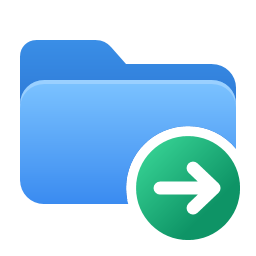
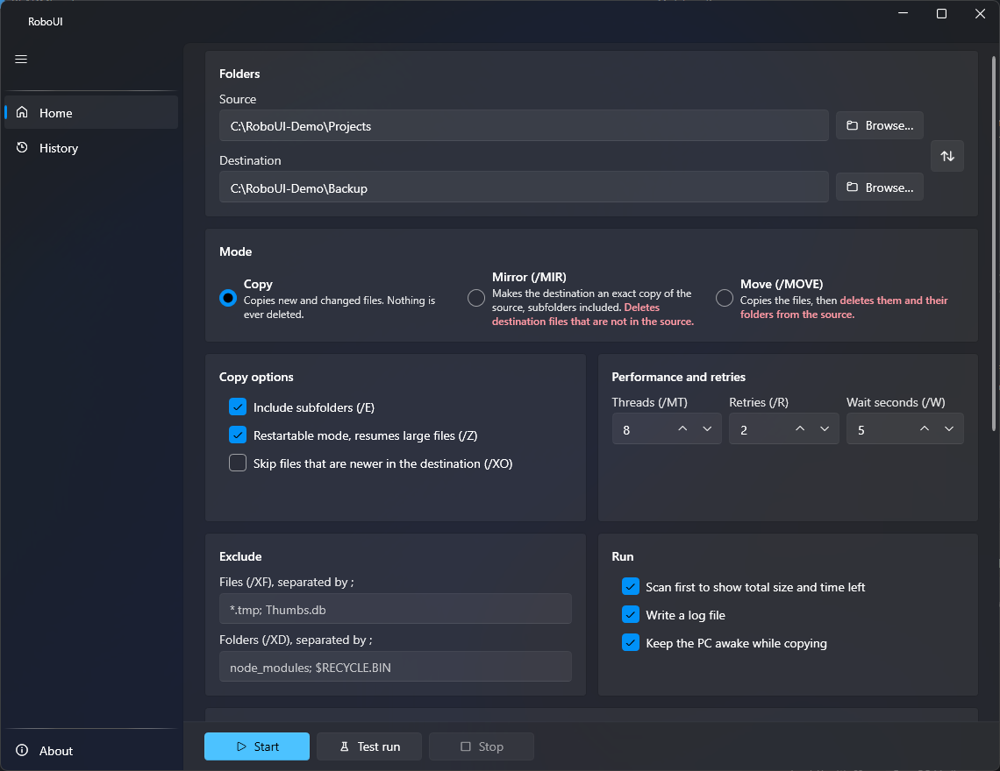
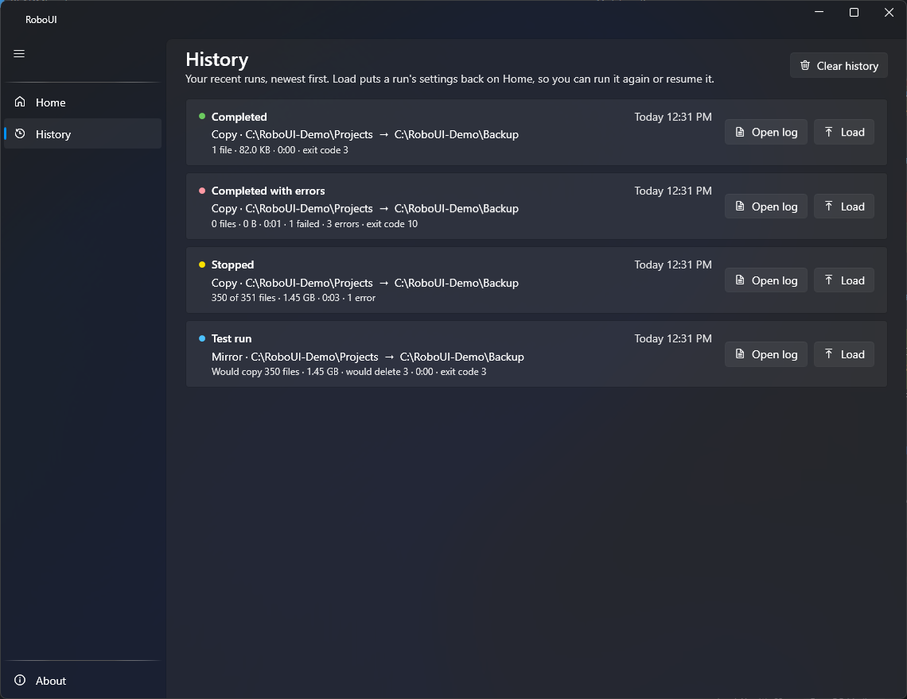
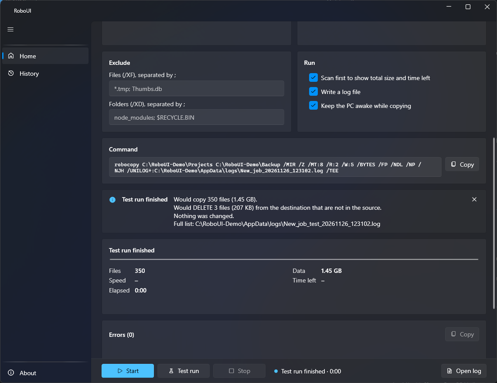

<p align="center">
  
</p>

# RoboUI

**A modern Windows front end for robocopy.** Start a large copy, stop it at any time, shut down the PC, and resume the next day.

RoboUI doesn't copy anything itself. `robocopy.exe`, which ships with Windows, does all the copying. RoboUI builds the command, runs it, shows live progress, and keeps a history of your runs, so you get robocopy's reliability without memorizing its switches.



## Features

- **Three modes, clearly explained.**
  - **Copy:** copies new and changed files and never deletes anything.
  - **Mirror** (`/MIR`): makes the destination an exact copy of the source, which deletes destination files that aren't in the source.
  - **Move** (`/MOVE`): copies the files, then deletes them from the source.
- **Test run.** Runs the exact same command with `/L`, so robocopy only lists what it *would* copy or delete. Nothing on disk changes.
- **Stop and resume.** Stop ends robocopy immediately. Resume runs the same command again: files that are already identical are skipped, and partly copied files are copied again (or continued, in restartable mode).
- **Live progress.** Shows files and data done, speed over the last 20 seconds, time left, elapsed time, and the current file. A status line in the bottom bar keeps it visible while you scroll, and the taskbar button shows progress while the window is minimized.
- **Pre-scan.** An optional listing pass first counts how many files and bytes will be copied, so the progress bar and time left are accurate.
- **Safety first.**
  - Mirror and Move always ask before running, and the warning names the folder that will lose files.
  - The source and destination are checked before starting: the source must exist, and the destination can't be inside the source.
  - Progress never runs ahead: a file counts as done only after robocopy has finished it.
- **Errors panel.** Shows the latest 500 error lines with robocopy's explanation for each, and a Copy button for pasting them elsewhere.
- **History.** Every run is kept with its outcome, counts, duration and log. **Load** puts a past run's settings back on the Home page, so after a restart you can continue a stopped job with one click.
- **Notifications.** A Windows notification tells you when a run finishes while RoboUI is in the background. Clicking it brings RoboUI back. You can turn it off in **Settings**.
- **Taskbar controls.** Start and Stop buttons appear in the taskbar thumbnail when you hover over RoboUI's icon.
- **Logs.** Each run writes a Unicode log, which you can open from the app.
- **Keeps the PC awake** while a copy runs (optional), and asks before closing the window during a copy.
- **Live command preview** that you can copy and run yourself in a terminal.
- **Fluent design.** Mica background, sidebar navigation, and light and dark themes, built with [WPF UI](https://github.com/lepoco/wpfui). By default RoboUI follows the Windows theme and accent colour. You can choose a fixed theme in **Settings**.

| History | Test run with Mirror |
|---|---|
|  |  |

## Requirements

- Windows 10 or Windows 11 (x64)
- To run a published build: nothing else. The self-contained build includes .NET.
- To build from source: the [.NET 10 SDK](https://dotnet.microsoft.com/download)

## Getting started

```powershell
git clone https://github.com/f0lder/RoboUI.git
cd RoboUI
dotnet run --project RoboUI
```

### Build a single .exe

```powershell
dotnet publish RoboUI -c Release -r win-x64 --self-contained `
  -p:PublishSingleFile=true -p:IncludeNativeLibrariesForSelfExtract=true
```

The result is in `RoboUI\bin\Release\net10.0-windows10.0.19041.0\win-x64\publish\`. It's a single file that runs on any Windows 10 or 11 x64 PC without installing .NET. The file is fairly large (roughly 70–150 MB) because it includes the runtime.

## How to use it

1. Choose a **source** and a **destination** folder. You can type the paths, use **Browse…**, or drag folders from Explorer. The ⇅ button swaps them.
2. Pick a **mode**: Copy, Mirror or Move.
3. Adjust the options if needed: subfolders, restartable mode, skipping files that are newer in the destination, threads, retries, and files or folders to exclude.
4. Press **Test run** to see what would happen. Nothing is changed.
5. Press **Start**. You can press **Stop** at any time.

### How resume works

Robocopy compares the source and destination every time it runs, so resuming is simply running the same command again:

- Files that are already identical in the destination are **skipped**.
- A file that was being copied when you stopped is **copied again**. With *restartable mode* (`/Z`), robocopy can continue a large file from where it stopped.
- In **Move** mode, RoboUI also passes `/IS /IT /IM`. Without these, a file that was copied but not yet deleted from the source when you stopped would be skipped on resume and stay in the source forever.

After closing the app, open **History** and press **Load** on the stopped run. The button on Home then reads **Resume**.

## Good to know

- **Progress may pause behind large files.** With multiple threads (`/MT`), robocopy reports files in their original order as each one finishes. While a large file is copying, files after it may already be done but are reported only once the large file finishes.
- **Cloud folders (OneDrive, ownCloud, Nextcloud…)** may contain *online-only* placeholder files whose contents aren't on your PC. When robocopy reads one, Windows asks the sync client to download it first. That's slow, and it can fail with error 426 (*"The cloud operation was not completed before the time-out period expired"*) if the client doesn't respond. For best results, make the folder "always available on this device" and let it finish syncing before you copy.
- **Exit codes** are shown in plain language. Codes 0–7 mean success, 8 or higher means some files couldn't be copied, and 16 means robocopy couldn't run at all.

## Where RoboUI keeps its data

| What | Where |
|---|---|
| Logs | `%APPDATA%\RoboUI\logs\<job>_<yyyyMMdd_HHmmss>.log` |
| Run history (newest 200 runs) | `%APPDATA%\RoboUI\history.json` |
| Settings | `%APPDATA%\RoboUI\settings.json` |
| Notification name and icon | `HKCU\Software\Classes\AppUserModelId\f0lder.RoboUI`, and `%APPDATA%\RoboUI\RoboUI.png` |

Nothing is sent anywhere. RoboUI has no telemetry and doesn't check for updates.

## Project structure

```
RoboUI.slnx
├── RoboUI.Core/          Class library, no UI code
│   ├── Models/           CopyJob, CopyMode
│   ├── Robocopy/         Command builder, output parser, runner, exit-code interpreter
│   ├── Progress/         Progress tracker, speed meter
│   ├── History/          Run history (JSON)
│   ├── Settings/         App settings (JSON)
│   └── Validation/       Pre-start checks
├── RoboUI/               WPF app: MVVM with CommunityToolkit.Mvvm, DI via Microsoft.Extensions.Hosting
│   ├── Views/            Home, History, Settings, About pages
│   ├── ViewModels/
│   └── Services/         Dialogs, keep-awake, history, settings, notifications, app paths
├── RoboUI.Core.Tests/    xUnit tests for everything in Core that doesn't start a process
└── tools/IconGen/        Draws the app icon and writes RoboUI/Assets/RoboUI.ico, .png and .svg
```

Some design notes:

- **Robocopy runs with machine-readable output** (`/BYTES /FP /NDL /NP /NJH`), and its output is decoded with the console's OEM code page. File lines are recognized by their structure rather than their text, so localized versions of robocopy work too.
- **Paths are quoted carefully.** Robocopy misreads a quoted path that ends in `\`, so trailing backslashes are removed, drive roots are passed as `D:\` without quotes, and only paths with spaces are quoted.
- **The UI never blocks.** Robocopy runs on a background thread, and the screen refreshes about four times a second from a summary, so even very large jobs (100,000+ files) stay responsive.
- **Mirror and Move can't run without confirmation.** The runner refuses to start a deleting copy unless the user has confirmed it.

### Run the tests

```powershell
dotnet test
```

### Releasing

Push a version tag and GitHub Actions does the rest: it runs the tests, publishes `RoboUI.exe`, creates the GitHub release, and opens a winget-pkgs pull request.

```powershell
git tag 0.2.0
git push origin 0.2.0
```

## Roadmap

- [ ] Saved jobs in the sidebar (add, rename, duplicate, delete)
- [x] Taskbar progress
- [ ] Tray icon
- [x] Notification when a job finishes
- [x] Start and Stop buttons in the taskbar thumbnail
- [ ] Optional sleep or shut down after a job, with a countdown
- [x] Follow the Windows light/dark theme and accent colour
- [x] Settings page (theme, notifications)

## Built with

- [.NET 10](https://dotnet.microsoft.com/) and WPF
- [WPF UI](https://github.com/lepoco/wpfui): Fluent controls and Mica
- [CommunityToolkit.Mvvm](https://github.com/CommunityToolkit/dotnet): MVVM source generators
- [Microsoft.Extensions.Hosting](https://learn.microsoft.com/dotnet/core/extensions/generic-host): dependency injection
- [xUnit](https://xunit.net/): tests

## License

[MIT](LICENSE) © f0lder
